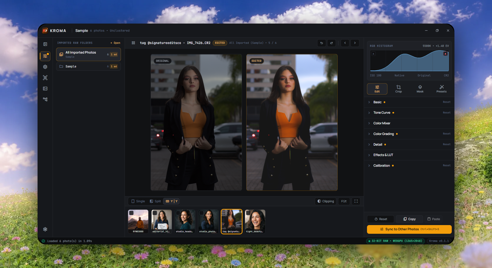

<div align="center">
  
  <h1>Kroma</h1>
</div>

<p align="center">
  
</p>

## About

Kroma is a **local-first desktop RAW photo editor and portrait workflow studio** with a **32-bit GPU develop engine**, **AI face organization**, and **offline whiteboard OCR** built for fast high-volume shoots.

> [!NOTE]
> All AI models (face detection, face recognition, Slate OCR, and subject masking) run 100% locally on your device. On first launch, Kroma automatically downloads and SHA-256 verifies the model weights from [GitHub Releases](https://github.com/ByteKen/kroma/releases).

> [!IMPORTANT]
> Kroma is strictly **non-destructive**. Your original RAW and image files are never modified—all develop edits, masks, and subject groupings are stored in lightweight `.kroma.json` sidecar metadata.

## Features

- **Cross-Platform Native App:** Built with Rust and Tauri v2 for Windows and macOS, with recent projects catalog, pinning, and automatic release update checks
- **32-Bit Wide-Gamut Develop Engine:** Unified WGSL compute pipeline running on WebGPU (live studio, with automatic WebGL2 fallback) and `wgpu` DX12/Metal (batch export) in Linear Rec.2020 color space
- **Full RAW & Image Support:** Fast native decoding for 29+ camera RAW formats (ARW, CR2, CR3, NEF, RAF, DNG, ORF, RW2, and more) alongside JPEG, PNG, and TIFF
- **Non-Destructive Grading & Presets:** White balance, exposure, tone curves, HSL color mixer, 3-way color grading wheels, film grain, crop/level, built-in & custom presets, and 3D `.cube` LUT support
- **AI Masking & Backdrop Replacement:** Local `RMBG-1.4` subject/background segmentation, non-destructive studio background replacement (solid, linear/radial gradient, or transparent), plus brush, linear/radial gradient, and luminance/color range masks
- **Batch Sync & Portrait Calibration:** Selective module sync, copy/paste recipes, relative exposure/WB nudges across multi-selected frames, 1-click eye-horizon auto-leveling, and 1-click white balance calibration from whiteboard/slate frames
- **Live Scopes & Comparison Views:** Real-time RGB histogram, highlight/shadow clipping overlays, Split Before/After, Side-by-Side (`Y|Y`), Focus Mode, and full-screen Lightbox
- **Face Organizer & Manual Culling:** On-demand subject clustering (YuNet + ArcFace R50 512-D) with Time Assist, Ambiguous Review Queue, Manual Match Split View, drag-and-drop merge/split/move, smart bins, nested virtual folders, and independent Develop & Organization undo/redo
- **Slate OCR:** Local PP-OCRv5 whiteboard and name-card scanning with high-resolution RAW fallback to automatically extract subject names and codes
- **Selective Batch Export:** Export full shoots, specific folders, or selected frames as graded JPEG, PNG, or 16-bit TIFF with optional original RAW pairing, custom naming patterns, automatic slate exclusion/archiving, and real-time output size estimation
- **Offline-First & Configurable AI:** Zero cloud uploads and zero subscriptions; hardware-accelerated via DirectML (Windows) and CoreML (macOS), with custom `.onnx` model inspection/swapping and configurable cache directories

## Installation

Download the latest installer for Windows (64-bit) or macOS (Apple Silicon) from the [Releases](https://github.com/ByteKen/kroma/releases) page.

## Development

Kroma is built with **Rust**, **Tauri v2**, **React 19**, **TypeScript**, and **WGSL**.

### Prerequisites

- [Rust](https://www.rust-lang.org/tools/install) (Edition 2024 / stable toolchain)
- [Node.js](https://nodejs.org/) (v20+)
- Platform Tauri v2 build dependencies ([Tauri prerequisites](https://v2.tauri.app/start/prerequisites/))

### Run Locally

```bash
# Install frontend dependencies
npm --prefix kroma-web install

# Launch the desktop app in development mode
npm --prefix kroma-web run tauri:dev

# Build a production desktop bundle
npm --prefix kroma-web run tauri:build
```

> [!NOTE]
> See [CHANGELOG.md](./CHANGELOG.md) for release history and [models/models.json](./models/models.json) for the bundled AI model manifest.

## License

Kroma's source code is licensed under the [Apache License 2.0](./LICENSE).

> [!NOTE]
> The default ONNX AI models downloaded on first launch remain governed by their respective upstream licenses: **YuNet** (MIT), **PP-OCRv5** (Apache-2.0), **InsightFace ArcFace `w600k_r50`** (non-commercial research), and **BRIA `RMBG-1.4`** (non-commercial). You can configure custom `.onnx` models in **Settings → Models**.
